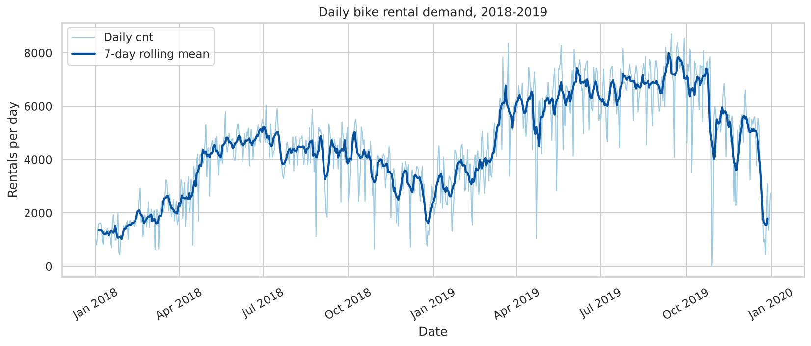
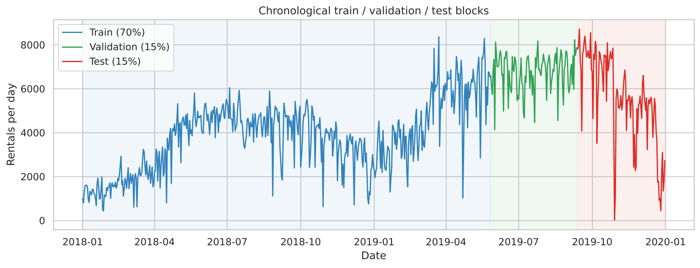
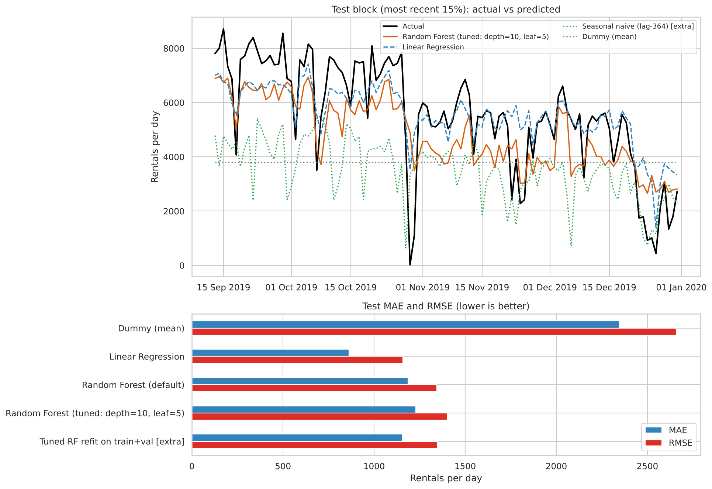
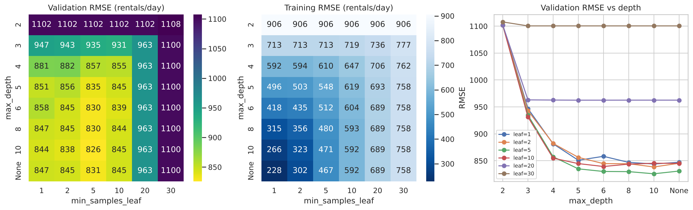
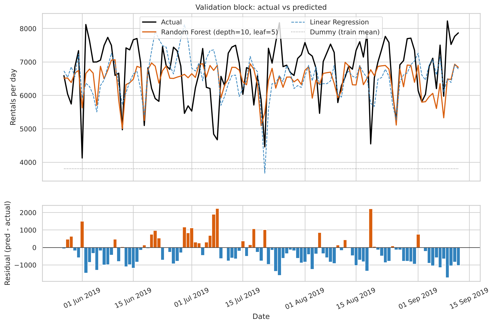
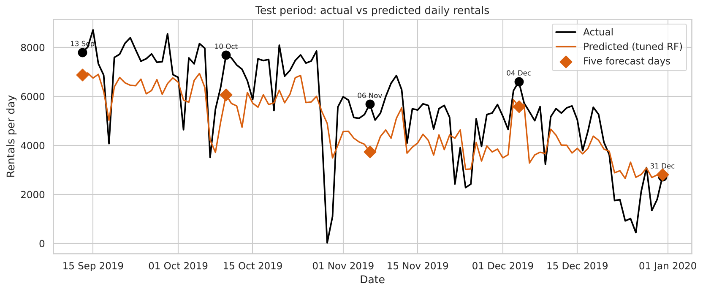
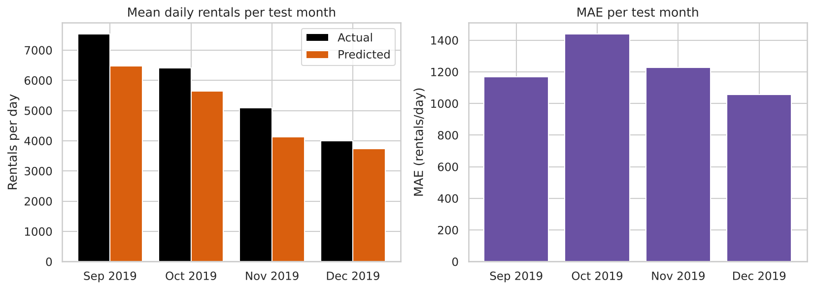

# Results and Analysis – Bike Rental Demand Forecasting

All numbers come from the executed notebook (`Bike_Rental_Demand_Forecasting.ipynb`, seed 42, scikit-learn 1.9.1). Tables are in this folder as CSV/JSON; figures are in `figures/`.

## 1. Data and split
* 730 daily records, 1 Jan 2018 – 31 Dec 2019, no missing values, no gaps (`split_summary.csv`).
* Chronological split: **Train 511 d** (2018-01-01 → 2019-05-26, mean 3,803) · **Validation 109 d** (2019-05-27 → 09-12, mean 6,757) · **Test 110 d** (2019-09-13 → 12-31, mean 5,552).
* Leakage: `cnt = casual + registered` exactly; a linear model with those columns scores R² = 1.000 (MAE 0), without them MAE 834 / R² 0.53 (70/30 chronological check).

## 2. Key EDA findings
| Group | Mean daily rentals |
|---|---|
| Winter / Spring / Summer / Fall | 2,608 / 4,992 / 5,644 / 4,728 |
| Clear / Mist / Light rain-snow | 4,877 / 4,045 / 1,803 (21 days) |
| 2018 / 2019 | 3,406 / 5,610 (+65 %) |

Temperature correlates r = 0.63 with demand; `temp` and `atemp` r = 0.99 (`atemp` dropped).

## 3. Model comparison (train-only fit)
| Model | Train RMSE | Val MAE | Val RMSE | **Test MAE** | **Test RMSE** | Test R² | Test bias |
|---|---|---|---|---|---|---|---|
| Dummy (mean) | 1,587 | 2,954 | 3,076 | 2,347 | 2,657 | −0.76 | −1,749 |
| Linear Regression | 625 | 779 | 959 | **863** | **1,158** | **0.67** | +10 |
| Random Forest (default) | 228 | 700 | 847 | 1,187 | 1,344 | 0.55 | −706 |
| **Random Forest (tuned: depth 10, leaf 5)** | 471 | 681 | **826** | 1,229 | 1,402 | 0.51 | −726 |
| *extra* Seasonal naive (lag-364) | – | – | – | 2,260 | 2,606 | −0.70 | −2,006 |
| *extra* Tuned RF refit on train+val | – | – | – | 1,155 | 1,345 | 0.55 | −641 |

**Required final result (tuned Random Forest, test block): MAE = 1,229, RMSE = 1,402 rentals/day** (≈ 22 % of average test demand).

## 4. Tuning (Task 7)
48 settings evaluated on validation only (`task7_tuning_grid.csv`, Fig. 7). Best: depth 10 / leaf 5 (val RMSE 825.8) vs default 847.1. The top five settings all use leaf 5 and differ by only ≈ 5 RMSE; leaf ≥ 20 is clearly worse (val RMSE ≥ 963). The optimum is a plateau, not a sharp peak.

## 5. Generalisation diagnostics (Task 8)
Tuned forest: train RMSE 470.5 → validation 825.8 (1.76×); default forest: 228 → 847 (3.7×). Validation bias −285/day: peaks are flattened because the validation summer is hotter than most of the training data and the 2019 level was seen in training only for Jan–May.

## 6. Test analysis (Tasks 9–10)
**Why is Linear Regression better on test than the forest that won validation?** Demand grew ~65 % between years. The linear model learns an additive `yr` effect that carries over to autumn 2019 (bias +10). The forest saw `yr = 1` only in Jan–May (low season) and therefore sits close to 2018 levels for autumn days (bias −726). The validation block could not reveal this, because it was dominated by hot summer days.

Five-day forecast (tuned RF):

| Date | Weather | Actual | Predicted | Error |
|---|---|---|---|---|
| 2019-09-13 | Clear | 7,804 | 6,885 | −919 |
| 2019-10-10 | Clear | 7,691 | 6,065 | −1,626 |
| 2019-11-06 | Clear | 5,686 | 3,735 | −1,951 |
| 2019-12-04 | Clear | 6,606 | 5,590 | −1,016 |
| 2019-12-31 | Mist/Cloudy | 2,729 | 2,812 | +83 |

Monthly seasonal breakdown (tuned RF): Sep MAE 1,168 (15.5 %), Oct 1,439 (22.4 %), Nov 1,228 (24.1 %), Dec 1,056 (26.5 %); mean actual demand falls 7,530 → 3,991 (−47 %) as temperature falls 24.0 → 13.2 °C; the model reproduces the shape, but under-predicts in every month (bias −1,062 / −766 / −964 / −262).

Feature importance: impurity importance puts `temp` (0.57) and `yr` (0.23) first; permutation importance on the (shifted) validation block ranks `hum` (+85 RMSE) and `windspeed` (+48) first and gives ≈ 0 to `temp`/`yr`. The two views disagree, which itself signals distribution shift.

## 7. Key findings
1. Calendar + weather explain a large share of demand: every learned model beats the dummy by ≥ 48 % in MAE.
2. Removing leakage columns turns a "perfect" model into an honest one (R² 0.53 on the check split).
3. Trend/growth is the dominant source of forecast error; tree models cannot extrapolate it.
4. A validation block with a different season/level than the test block is an unreliable guide: the validation-selected forest lost to Linear Regression on test.
5. Retraining on the most recent data (train+val) helps (MAE 1,229 → 1,155).

## 8. Limitations
* One 110-day test block and one forest seed; no confidence intervals (differences of a few RMSE points are noise).
* Only two years of data – each season is seen once per level; growth cannot be separated from seasonality with certainty.
* Observed (not forecast) weather is used; unobservable events (the 22-rental day on 2019-10-29) cannot be predicted.
* Hyper-parameter grid is limited to depth and leaf size, as the assignment asks.

## 9. Potential improvements
Detrended target or explicit time index with linear-tree hybrids; lag/rolling features (previous-week demand); gradient boosting; rolling-origin cross-validation with several folds; prediction intervals (quantile forests); weather forecasts as inputs; periodic re-training.
